# Order Ingestion & Dispatch

A small full-stack system that takes food orders from three different sources, merges them into one order model with a full event history, schedules them, and hands them to an assembly robot.

- **Backend:** Go (standard library + `lib/pq`), Postgres 16
- **Frontend:** Vue 3 + TypeScript (Vite), hand-rolled CSS, light and dark themes
- **Runtime:** docker compose; every service is stateless and scales horizontally

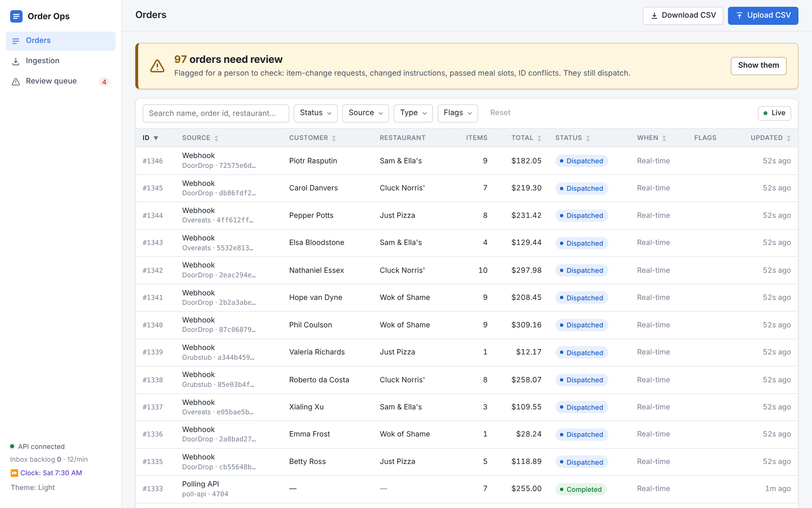

---

## Quick start

```bash
docker compose up --build        # first build takes a minute or two
open http://localhost:8080       # UI (also proxies the API at /api)
```

Then load the sample data, either from the UI (**Ingestion** page) or from a terminal:

```bash
make demo        # replays webhook_orders.jsonl, then uploads orders_1..4.csv
```

The polling API source starts on its own: the `mock-api` container releases one recorded response every 3 seconds and the poller picks them up, so the 60 API orders arrive and progress to *completed* over about five minutes.

Useful extras:

| Command | What it does |
|---|---|
| `make scale` | 3 API replicas + 4 workers (`docker compose up -d --scale api=3 --scale worker=4`) |
| `make webhook-burst` | 2,000 brand-new webhook orders with a bursty traffic profile |
| `make logs` | Follow api + worker logs (structured JSON) |
| `make reset` | Stop everything and delete the database volume |
| `make test` | Go unit tests + frontend type-check |

Set `PORT=9000` to serve the UI elsewhere. Meal times, lead time and time zone are environment variables (see `docker-compose.yml`).

<details>
<summary>Running without Docker (development)</summary>

```bash
# Postgres 16 on localhost:5432 with user/password/db "orders", then:
cd backend
go run ./cmd/mock-api &                       # :8090, reads ../sample-data
go run ./cmd/server                           # :8080, all roles in one process
cd ../frontend && npm install && npm run dev  # :5173, proxies /api to :8080
```

`DATABASE_URL` overrides the connection string.
</details>

---

## Injecting orders

Every source has a mock, and each can be driven from the UI or a terminal.

| Source | UI (Ingestion page) | Terminal |
|---|---|---|
| **Webhook** (real-time, bursty) | *Inject new orders* (random sample orders with fresh UUIDs) or *Replay sample file* (verbatim, including its duplicates, cancels and conflicts) | `docker compose run --rm mock-webhook --fresh --count 2000 --rate 50 --burst 300`<br>`curl -XPOST localhost:8080/api/ingest/webhook -d @order.json` (a single object, a JSON array, or NDJSON) |
| **CSV upload** (scheduled) | **Upload CSV** in the header, or the sample-file buttons | `curl -F file=@sample-data/orders_2.csv localhost:8080/api/orders/import` |
| **Polling API** | *Poll now* | The `mock-api` container replays `api_responses.jsonl`; `MOCK_API_STEP=500ms docker compose up -d mock-api` speeds it up |

The **Clock** panel moves system time forward ("time warp") so scheduled orders can be watched leaving the schedule without waiting for lunch. *Reset all data* clears everything and rewinds the mock API.

---

## Architecture

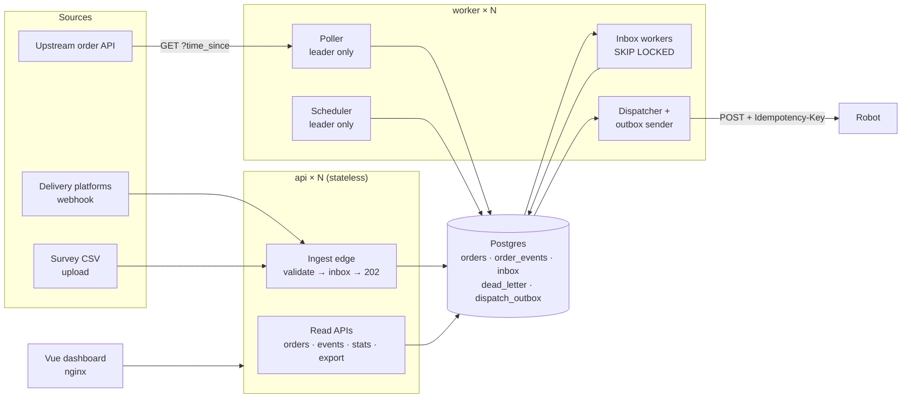

### Containers

| Service | Role | Scaling |
|---|---|---|
| `db` | Postgres 16: all state, on a named volume | one (managed Postgres in production) |
| `api` | Ingest edge, read APIs, admin actions | stateless; nginx round-robins across replicas |
| `worker` | Inbox workers, dispatcher, outbox sender, poller, scheduler | any number; work is claimed with `FOR UPDATE SKIP LOCKED`, and the poller and scheduler are leader-elected |
| `frontend` | nginx serving the built Vue app; proxies `/api` | stateless |
| `mock-api` | Replays `api_responses.jsonl` (including its 500s) and plays the robot | — |
| `mock-webhook` | On-demand load generator for the webhook edge | `docker compose run` |

All Go roles are one binary (`server --roles=api` or `--roles=workers,dispatch,poller,scheduler`), so a laptop can run everything in one process and production can split it up.

### How an order flows

1. **Ingest edge.** `POST /api/ingest/webhook` and `POST /api/orders/import` validate only what is needed to identify the payload, write it to the `inbox` table and return `202`/`200`. The idempotency key is `source + external id + hash(payload)`. A repeat delivery is stored as a *duplicate* row, so it appears in the order's history but is never applied twice.
2. **Inbox workers** claim one row at a time with `FOR UPDATE SKIP LOCKED` and process it **in the same transaction**: normalize the payload, create or update the order and append to `order_events`. A crash rolls everything back and the row becomes claimable again. Failures retry with exponential backoff and jitter. Bad payloads, and rows that keep failing, go to `dead_letter`.
3. **Poller** (one active instance) calls `GET /orders?time_since=<cursor>` and enqueues one inbox row per upstream order:
   - **200:** enqueue the deltas, then advance the cursor.
   - **500 with partial data:** enqueue what arrived (applying it is idempotent) but **don't** advance the cursor.
   - **500 without data, or a network error:** keep the cursor and back off.

   It enqueues before advancing the cursor, so a crash between the two steps just re-fetches the same deltas, and those become harmless duplicates.
4. **Scheduler** (one active instance) moves `scheduled → queued` once `now ≥ meal slot − 30 min`.
5. **Dispatcher** moves `queued → dispatched` in one transaction that also writes the robot payload to `dispatch_outbox`. The **outbox sender** POSTs it to the robot with an `Idempotency-Key` and retries with backoff. Delivery is at-least-once, and the robot de-duplicates by key.
6. **Cancellation.** Before dispatch, the order simply becomes `cancelled`. After dispatch the food may already be in progress, so we record a `cancel_requested` event, flag the order, and send a cancel message through the same outbox.

**Lifecycle:** `received → scheduled | queued → dispatched → out_for_delivery → completed`, plus the terminal states `cancelled` and `rejected`. Statuses only ever move forward. `needs_review` is a **flag, not a state**: flagged orders still dispatch.

### Data model

| Table | Purpose |
|---|---|
| `orders` | Canonical order. Unique on `(source, external_id)`; also stores the raw upstream status, flags and schedule |
| `order_items` | Lines, keyed by upstream item hash (API) or position (webhook/CSV) |
| `order_events` | Append-only history: every state change, duplicate, conflict, robot ack… |
| `inbox` | Durable buffer between the edge and the workers |
| `dead_letter` | Refused or failed payloads, with the reason, kept for review |
| `dispatch_outbox` | Transactional outbox of robot messages |
| `ingest_cursors`, `leaders`, `csv_uploads`, `app_settings` | Poller cursor, leader heartbeats, upload audit, demo clock offset |

### Robot payload (skeleton)

```json
{
  "dispatch_id": "D-0000042",
  "order_id": 42,
  "source": "webhook",
  "external_id": "c59a0083-581d-4eb9-946e-98b32890be3a",
  "restaurant": "Sam & Ella's",
  "customer": { "first": "Laura", "last": "Kinney" },
  "items": [{ "name": "Lemon meringue pie", "qty": 1, "category": "Pie & Desserts" }],
  "notes": "Allergic to peanuts - please ensure no cross contamination",
  "flags": ["allergy"],
  "scheduled_for": null,
  "idempotency_key": "dispatch:42",
  "created_at": "2026-10-09T18:00:00Z"
}
```

---

## Decisions about the data

The sample files contain deliberate traps. This is how each one is handled:

| Situation | Decision |
|---|---|
| **Webhook exact duplicates** (2) | Same idempotency key, so the repeat is recorded as a `duplicate_received` event and dropped |
| **Webhook cancellations** (`update: ["cancelled"]`, 2) | Applied to the existing order (see *Cancellation* above). A cancel that arrives before its order is retried, then dead-lettered |
| **Webhook UUID collisions** (same id, different order, 2) | **First order wins.** The newcomer goes to the review queue as an `id_conflict`, linked from the original order's *Related deliveries* panel |
| **Empty / $0 orders** (2) | Created as `rejected` (so they are visible and searchable) and also dead-lettered with the reason |
| **"I know I added X…" / "Changed my mind –" notes** | Kept as notes and flagged `needs_review`. Dispatch is not blocked: a person decides, the robot doesn't guess |
| **Allergy notes** | Flagged `allergy`, and the flag goes to the robot |
| **API item-level deltas** | Grouped by order number. Each item's status only moves forward; the order's status is its least-advanced item's (an order is delivered when every item is). Upstream `with_courier` maps to `out_for_delivery` and `delivered` to `completed`. The raw upstream status is stored too |
| **API orders and the robot** | Dispatched on first sight (`ordered`/`processing`) |
| **CSV re-uploads** (each file is a superset of the previous one) | Row identity is `hash(normalized row) + occurrence number within the file`, so uploading 1, 2, 3 and 4 yields exactly 267 orders and re-uploads are no-ops |
| **CSV item lists** | Split on newlines and on commas outside parentheses, then fragments are re-joined when the joined text is a known menu item. This handles `Two eggs any style with bacon or sausage, hash browns, and toast`. Unknown items are kept and flagged |
| **CSV scheduling** | `tomorrow` + `meal` give a slot (breakfast 08:00, lunch 12:00, dinner 18:00 in `SLOT_TZ`), released 30 min early. If `tomorrow=false` and today's slot has already passed, the order moves to the same meal tomorrow and is flagged `slot_passed_rescheduled` |

---

## Design considerations

**Postgres as the queue.** At 100k requests/day (about 1.2/s on average, with bursts maybe 100× that), a dedicated broker would add an operational dependency without buying anything. The `inbox`/`outbox` tables give durable buffering, idempotency through unique keys, exactly-once *effects* (claim + apply + mark done in one transaction), easy inspection with SQL, and one less moving part. The edge does one indexed insert per request, so bursts land in Postgres instead of being dropped. [`NEXT_STEPS.md`](NEXT_STEPS.md) describes when to swap in Kafka/SQS.

**At-least-once in, exactly-once effects.** Every boundary assumes redelivery: inbox keys, `(source, external_id)` uniqueness, monotonic status updates, an idempotency key on robot messages, and enqueue-before-cursor in the poller. Nothing relies on a message arriving exactly once.

**Horizontal scaling without coordination services.** API replicas are stateless. Workers compete with `SKIP LOCKED`. Singletons (poller, scheduler) use Postgres session advisory locks: when the leader dies, Postgres drops its session and its lock, and another replica takes over (about 1 s in testing). No ZooKeeper, etcd or Redis.

**Go.** Static binaries in a `scratch` image (about 30 MB for three binaries plus the sample data), good concurrency primitives, and a standard library that covers HTTP routing (1.22 patterns), structured logging and JSON. The only dependency is the Postgres driver, which is vendored, so builds need no network.

**Fault tolerance by pipeline.**

- **Webhook:** durable inbox before `202`, retries with backoff, and a dead letter for poison payloads.
- **Polling API:** the cursor only advances on success, partial data is applied safely, and errors back off with jitter.
- **CSV:** the whole upload runs in one transaction, the header is validated, there is a size limit, and per-row rejections are reported with line numbers.
- **Robot:** a transactional outbox with retries. After the maximum number of attempts the order is flagged `robot_delivery_failed`.

**Maintainability.** All parsing and business rules live in `internal/normalize` as pure functions, with unit tests that run against the real sample files. Each pipeline is a small handler over the same inbox/worker machinery, so adding a fourth source means adding one handler.

**Cost.** One small managed Postgres plus a couple of tiny containers handles this load with a lot of headroom. Nothing idles expensively.

---

## HTTP API

| Method & path | Purpose |
|---|---|
| `POST /api/ingest/webhook` | Webhook edge (object, array or NDJSON) → `202 {accepted, duplicates, rejected[]}` |
| `POST /api/orders/import` | CSV upload (multipart `file`) → `{new, duplicate, rejected[{line, reason}]}` |
| `GET /api/orders` | List with filters. `status`, `source` and `kind` take comma-separated values. `flags` (comma-separated, `needs_review` included) matches orders with *any* of them. Different filters combine with AND. Also `q`, `sort`, `dir`, `page`, `page_size` |
| `GET /api/orders/export.csv` | The same filters, streamed as CSV (one row per order) |
| `GET /api/orders/{id}` | Order + items + events + robot payload (sent or preview) |
| `GET /api/orders/{id}/events` | History only |
| `GET /api/orders/{id}/related` | ID conflicts and dropped duplicate deliveries |
| `POST /api/orders/{id}/dispatch` | Release a received or scheduled order now |
| `POST /api/orders/{id}/cancel` | Cancel (or request a cancel from the robot if already dispatched) |
| `GET /api/stats` | Counts by status and source, inbox backlog, throughput, outbox, clock |
| `GET /api/dead-letter`, `POST /api/dead-letter/{id}/resolve` | Review queue |
| `GET /api/ingestion` | Poller cursor and last result, leaders, uploads, inbox by source |
| `POST /api/admin/time-warp` | `{"minutes": N}`, `{"to_next_release": true}` or `{"reset": true}` |
| `POST /api/admin/poll-now`, `/inject-webhook`, `/import-sample`, `/reset` | Demo helpers |
| `GET /healthz`, `GET /readyz` | Liveness, and readiness (DB reachable) |

---

## Verification

Run in a sandbox with the real compose stack (Postgres 16 in Docker):

| Check | Expected | Result |
|---|---|---|
| Webhook file, 1,004 lines | 998 orders (−2 dupes, −2 cancel updates, −2 conflicts); 2 cancellations recorded, 2 rejected, 2 conflicts in review | ✅ (the cancels end as `cancelled`, or as `cancel_requested` if the order had already reached the robot; this depends on replay speed) |
| CSV uploads 1→4, then 4 again | 267 orders; the second upload of file 4 is all duplicates | ✅ 75 / +39 / +75 / +78, then 0 new |
| Polling API replay | 60 orders; final status of all 264 items matches the file; the four 500s hold the cursor | ✅ |
| Time warp | Scheduled orders release and dispatch | ✅ |
| `--scale api=3 --scale worker=4` + 9,000 burst orders | Each order received once, dispatched at most once, one robot message each | ✅ 10,020 dispatches = 10,020 unique robot messages (509 injected robot 503s retried) |
| Load spread through nginx | Even across API replicas | ✅ 500 / 500 / 500 |
| `docker kill` the leader worker | Another worker takes over polling and scheduling | ✅ about 1 s |
| Restart Postgres under load | Services reconnect and nothing is lost or stuck | ✅ |
| Burst ingest, one API replica | — | 1,004 requests in 3 s, p99 26 ms; 3,000 at about 345 req/s, p99 130 ms |

`cd backend && go test ./...` covers CSV splitting (including the comma-in-name case and every item in all four sample files), stable row keys across cumulative files, meal-slot calculation, webhook parsing and flags, payload hashing, and status mapping and monotonicity.

---

## Screenshots

| | |
|---|---|
| 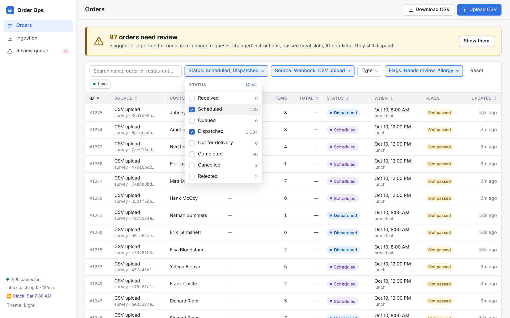 <br> **Filters:** multi-select Status (with live counts), Source, Type and Flags; Reset; everything kept in the URL | 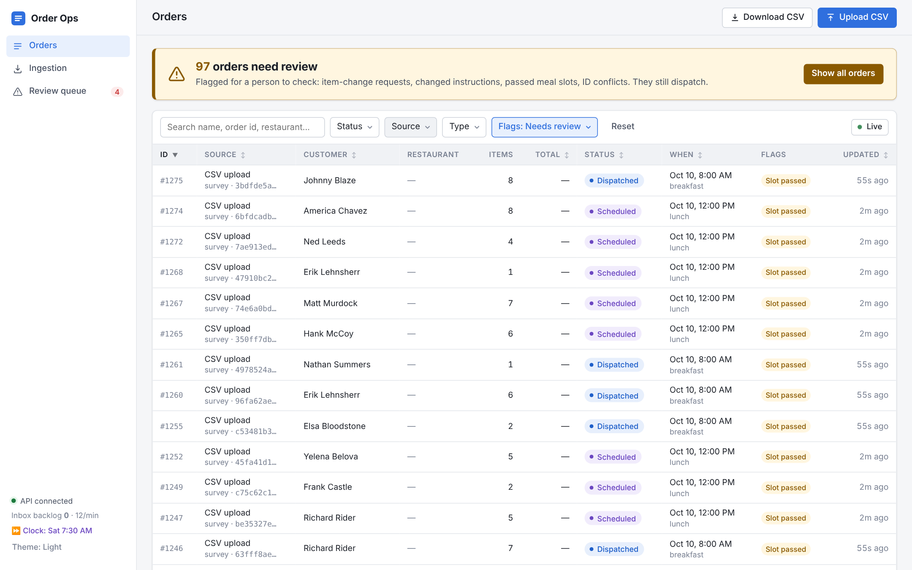 <br> **Needs review alert:** one click filters to the flagged orders |
| 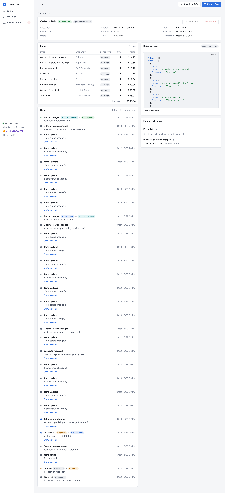 <br> **API order:** item-level upstream statuses, full event history, the robot payload as sent | 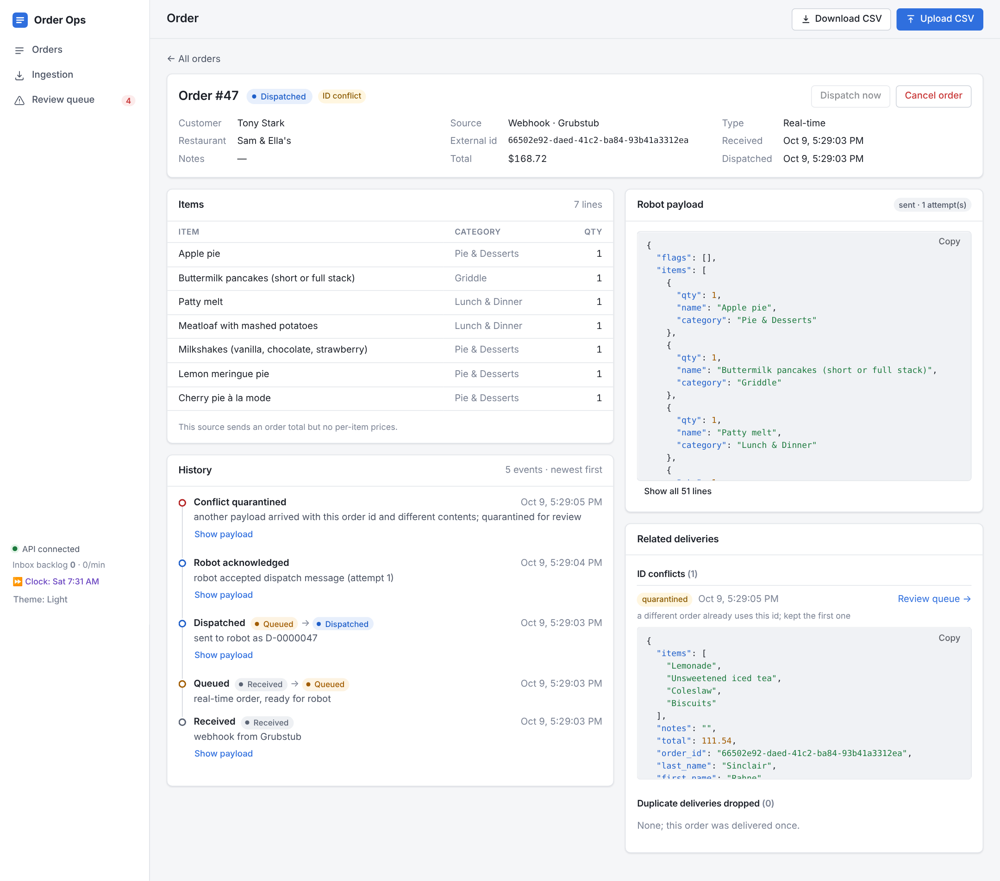 <br> **Webhook UUID collision:** first order kept; the conflicting payload is quarantined and linked |
| 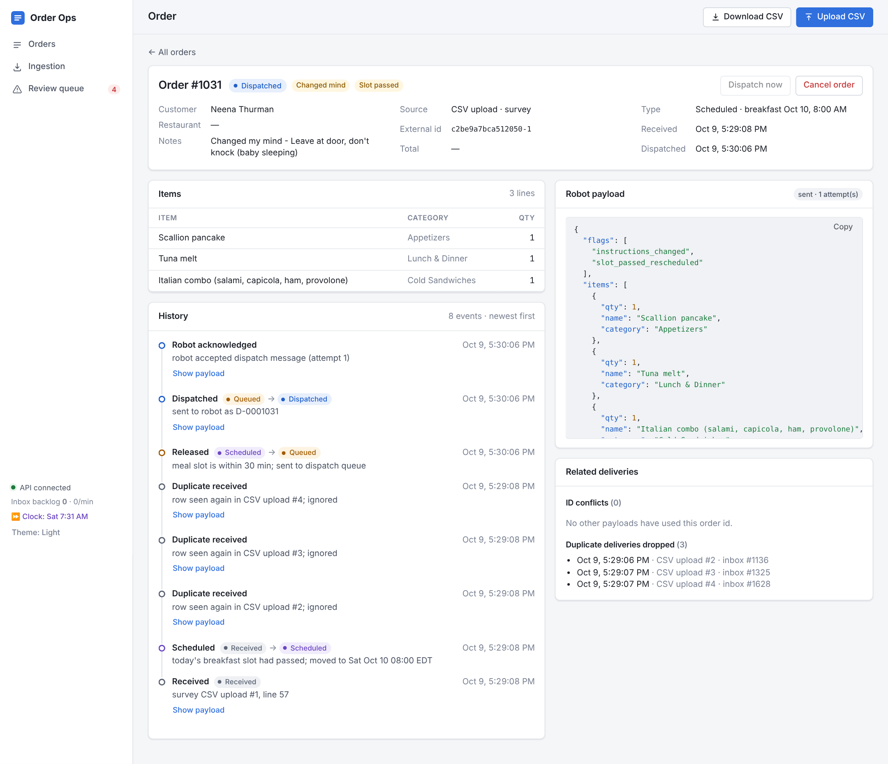 <br> **CSV order:** meal slot passed, so moved to tomorrow and flagged | 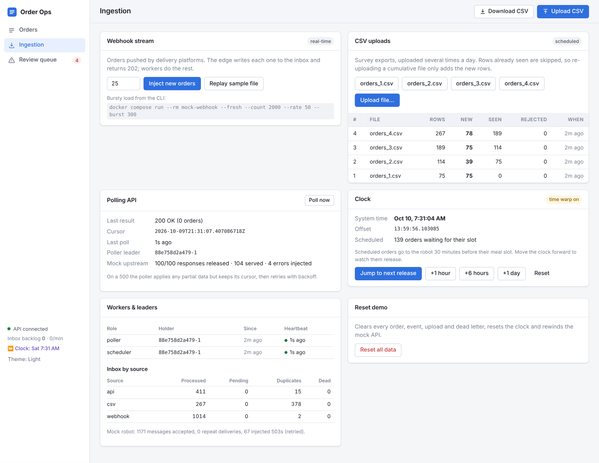 <br> **Ingestion:** inject orders, sample CSVs, poller state, time warp, leaders |
| 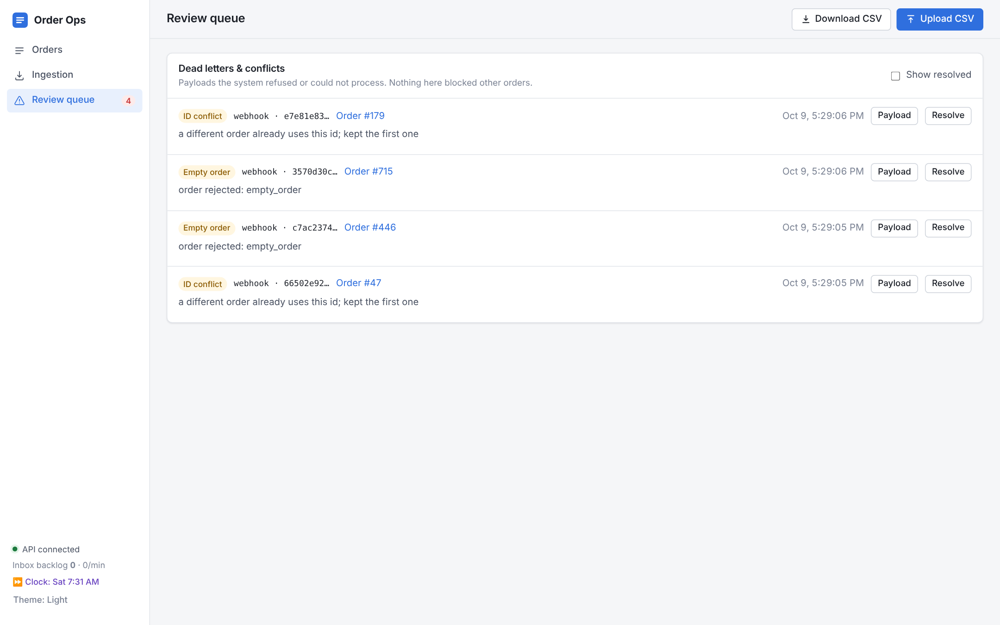 <br> **Review queue:** conflicts and rejected orders, with payloads | 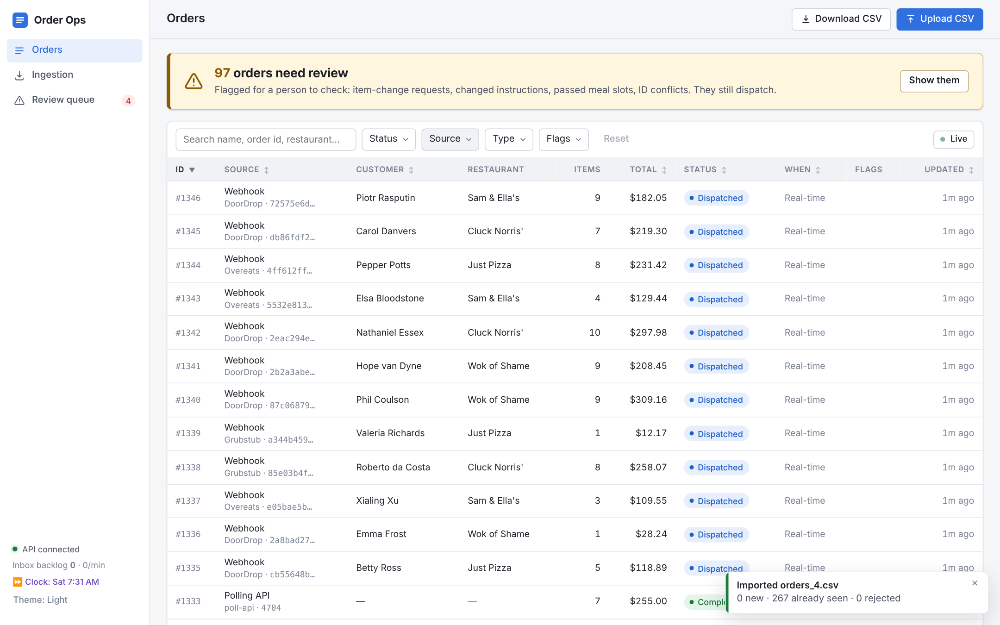 <br> **Re-uploading a CSV:** every row already seen |
| 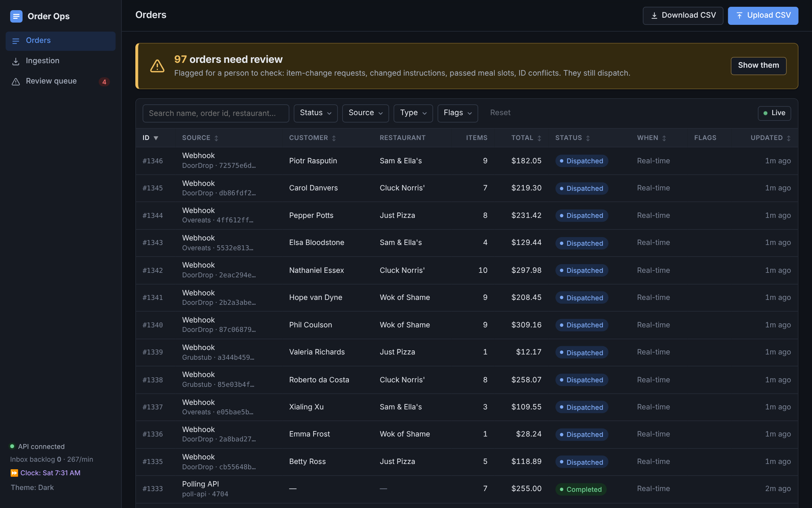 <br> **Dark theme** (follows the OS, or toggle) | 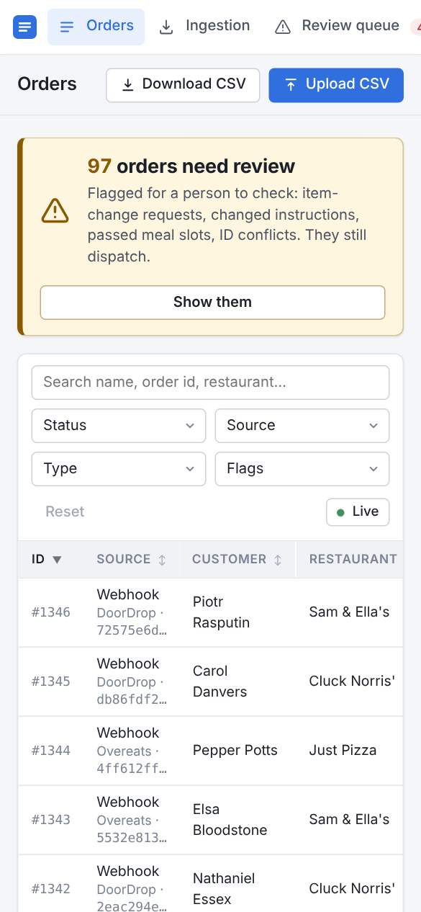 <br> **Phone width** |

---

## Project layout

```
backend/
  cmd/server          all roles (api, workers, dispatch, poller, scheduler)
  cmd/mock-api        upstream API replay + mock robot
  cmd/mock-webhook    bursty load generator
  internal/normalize  pure parsing & business rules (+ tests)
  internal/ingest     edge (inbox writes) and inbox workers
  internal/orders     transactional order operations, robot payload
  internal/poller     upstream API poller
  internal/scheduler  meal-slot release
  internal/dispatch   dispatcher + outbox sender
  internal/leader     advisory-lock leader election
  internal/httpapi    HTTP handlers
  migrations/         SQL schema (embedded, applied on start)
frontend/
  src/views           Orders, Order detail, Ingestion, Review queue
  src/components      MultiSelect, StatusBadge, DataTable, Timeline, JsonViewer, ToastHost
  src/filters.ts      URL ↔ filter parsing, selection labels, page size
sample-data/          the provided files (bundled into the image for the mocks)
docs/screenshots/
```

---

## Next steps

See [`NEXT_STEPS.md`](NEXT_STEPS.md). It covers the planned backend performance work (with measured baseline numbers), the automated test plan, frontend polish and production readiness.

---

## AI usage

This was built with Claude (Cowork). The planning and build session prompts are in [`PROMPTS.md`](PROMPTS.md).
